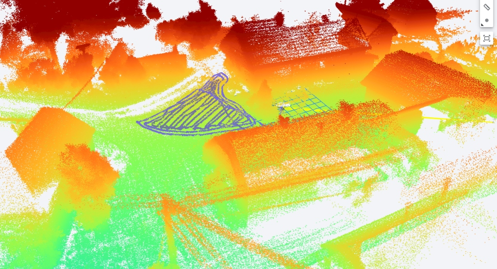

# Mowgli SLAM stack

Docker stack for Velodyne VLP16, GLIM mapping, and localization against a GLIM map.
The `main` branch combines the GLIM supervisor, localizer TF isolation, tools for
`fusion_graph`, and the Velodyne `min_range: 0.2` m filter.



## Images and startup

On push to `main`, GitHub Actions builds and publishes the `velodyne`, `glim`,
and `lidar_localization` images to `ghcr.io/lukaskrnac/3d_mowgli_slam_stack/`.
Tags are `latest` and `sha-<7 commit chars>`; PR builds do not publish images.
After a successful build, set a shared `SLAM_IMAGE_TAG` in `.env` if you want a pinned version.

```bash
cp .env.example .env
docker compose pull
docker compose up -d velodyne_driver glim lidar_localization
```

Local build: `docker compose build`. Paths in `volumes` are configured for
`/home/mowgli/mowglinext/docker/slam`; the corresponding configs, map, launch
file, and `cyclonedds.xml` must exist before starting. Compose does not modify
their contents. All services use host networking, CycloneDDS, and `ROS_DOMAIN_ID=0`.

The PCAP test is an optional profile. Stop the live driver first:

```bash
docker compose stop velodyne_driver
docker compose --profile test up velodyne_pcap_test lidar_localization
```

## GLIM supervisor

GLIM starts on demand from the MowgliNext GUI or via
`/glim_supervisor/start_mapping`. The supervisor manages mapping, saving, the
offline viewer, map merging, and exporting the active map.

- Sessions: host `glim_sessions` → `/glim/sessions`.
- Active map: host `glim_dump/garden_map.ply`; GLIM sees it at
  `/glim/active_map/garden_map.ply`, and the localizer at `/maps/garden_map/garden_map.ply`.
- Three backups are kept on export. Restart the localizer after swapping the map.
- `stop_grace_period: 3m` gives GLIM time to save the mapping session.

Details: [GLIM supervisor](glim/supervisor/README.md).

## Integration with MowgliNext fusion_graph

The current compose preserves the setup from the `lidar-loc-no-tf` branch:

- `/pcl_pose` is in the **`lidar_map`** frame. Conversion to `map` is handled by
  the `/calibrate_lidar_map_node/start` calibration on the MowgliNext side. Send
  `/initialpose` in the `lidar_map` frame; the map does not need to be aligned to
  ENU offline.
- The `base_link → lidar_link` extrinsic transform is published by the MowgliNext
  URDF. Velodyne uses `frame_id: lidar_link`; the localizer uses
  `publish_lidar_tf:=false`.
- The custom launch file `lidar_localization/launch/mowgli_lidar_localization.launch.py`
  remaps `/tf` to `/lidar_localization/tf`. This remap also affects the TF listener;
  Mode A (`enable_map_odom_tf:=false`) is used, not Mode B.
- Dynamic TF on the shared `/tf` topic is owned by MowgliNext. The localizer
  provides `/pcl_pose` measurements and `/alignment_status` diagnostics.

The localizer build also includes a patch adding the `publish_tf` parameter and
uses pinned upstream commits. `publish_tf: false` disables the TF broadcast itself;
it defaults to `true`, so existing host configurations keep the remap behavior.
Compose continues to load the **host `slam/config` directory** via the original
mount into `share/lidar_localization_ros2/param`, rather than the sample file from
this repository.

`lidar_localization/config/lidar_localization.yaml` is an optional sample
configuration (at `/config/lidar_localization.yaml` inside the image). It disables
TF broadcasting, publishes accepted matches, and computes fitness-based covariance.
To use it, pass the launch argument
`localization_param_dir:=/config/lidar_localization.yaml`; adjust its parameters
to match your map and initialization first.

Verification inside the container's ROS environment:

```bash
ros2 param get /velodyne_transform_node min_range
ros2 run tf2_ros tf2_echo base_link lidar_link
ros2 topic echo /pcl_pose --field header.frame_id --once
python3 /opt/tools/check_fusion_contract.py --duration 10 --pose-frame lidar_map --tf
```

The [historical fusion_graph specification](docs/ZADANIE_fusion_graph.md) describes
an older variant with an offline-aligned map; its requirement for the `map` frame
does not reflect the current compose setup.

## Non-ROS checks

```bash
python3 -m unittest discover -s glim/supervisor -p 'test_*.py' -v
docker compose config --quiet
```
